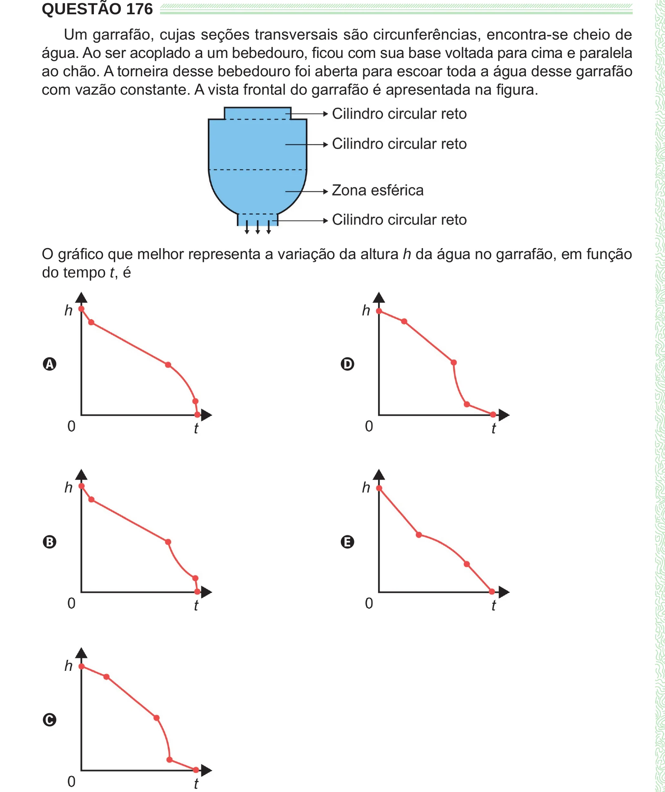

Texto extraído (pode conter ruído)

QUESTÃO 176  
Um garrafão, cujas seções transversais são circunferências, encontra-se cheio de  
água. Ao ser acoplado a um bebedouro, ficou com sua base voltada para cima e paralela  
ao chão. A torneira desse bebedouro foi aberta para escoar toda a água desse garrafão  
com vazão constante. A vista frontal do garrafão é apresentada na figura.  
O gráfico que melhor representa a variação da altura h da água no garrafão, em função  
do tempo t, é  
A  
D  
B  
E  
C

