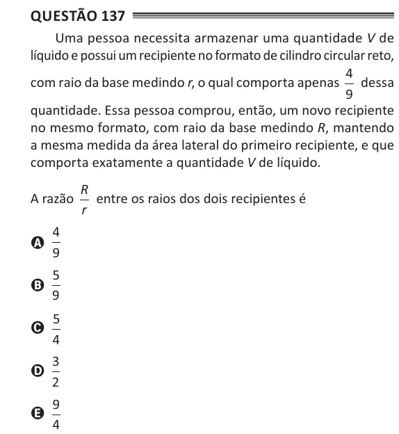

Texto extraído (pode conter ruído)

Questão 137  
Uma pessoa necessita armazenar uma quantidade V de  
líquido e possui um recipiente no formato de cilindro circular reto,  
4  
com raio da base medindo r, o qual comporta apenas dessa  
9  
quantidade. Essa pessoa comprou, então, um novo recipiente  
no mesmo formato, com raio da base medindo R, mantendo  
a mesma medida da área lateral do primeiro recipiente, e que  
comporta exatamente a quantidade V de líquido.  
R  
A razão  
entre os raios dos dois recipientes é  
r  
4  
A  
9  
5  
B  
9  
5  
C  
4  
3  
D  
2  
9  
E  
4

