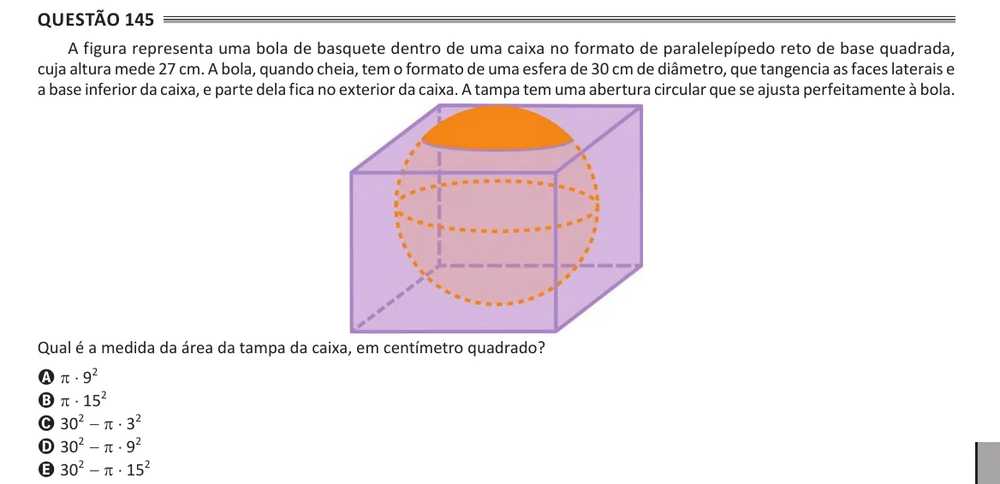

Texto extraído (pode conter ruído)

Questão 145  
A figura representa uma bola de basquete dentro de uma caixa no formato de paralelepípedo reto de base quadrada,  
cuja altura mede 27 cm. A bola, quando cheia, tem o formato de uma esfera de 30 cm de diâmetro, que tangencia as faces laterais e  
a base inferior da caixa, e parte dela fica no exterior da caixa. A tampa tem uma abertura circular que se ajusta perfeitamente à bola.  
Qual é a medida da área da tampa da caixa, em centímetro quadrado?  
A π ⋅ 9 2  
B π ⋅ 15 2  
C 30 2 - π ⋅ 3 2  
D 30 2 - π ⋅ 9 2  
E 30 2 - π ⋅ 15 2

