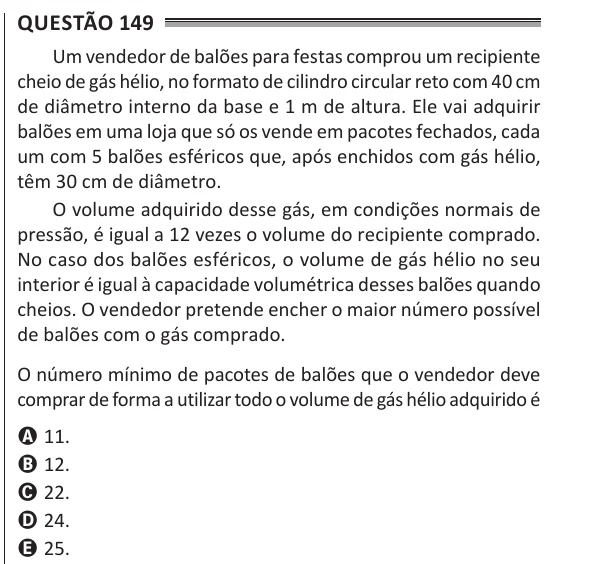

Texto extraído (pode conter ruído)

Questão 149  
Um vendedor de balões para festas comprou um recipiente  
cheio de gás hélio, no formato de cilindro circular reto com 40 cm  
de diâmetro interno da base e 1 m de altura. Ele vai adquirir  
balões em uma loja que só os vende em pacotes fechados, cada  
um com 5 balões esféricos que, após enchidos com gás hélio,  
têm 30 cm de diâmetro.  
O volume adquirido desse gás, em condições normais de  
pressão, é igual a 12 vezes o volume do recipiente comprado.  
No caso dos balões esféricos, o volume de gás hélio no seu  
interior é igual à capacidade volumétrica desses balões quando  
cheios. O vendedor pretende encher o maior número possível  
de balões com o gás comprado.  
O número mínimo de pacotes de balões que o vendedor deve  
comprar de forma a utilizar todo o volume de gás hélio adquirido é  
A 11.  
B 12.  
C 22.  
D 24.  
E 25.

