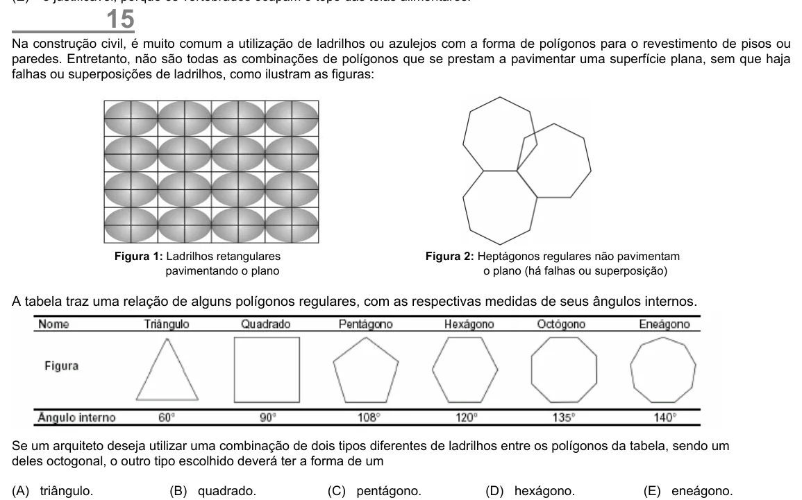

Texto extraído (pode conter ruído)

15  
Na construção civil, é muito comum a utilização de ladrilhos ou azulejos com a forma de polígonos para o revestimento de pisos ou  
paredes. Entretanto, não são todas as combinações de polígonos que se prestam a pavimentar uma superfície plana, sem que haja  
falhas ou superposições de ladrilhos, como ilustram as figuras:  
Figura 1: Ladrilhos retangulares  
Figura 2: Heptágonos regulares não pavimentam  
pavimentando o plano  
o plano (há falhas ou superposição)  
A tabela traz uma relação de alguns polígonos regulares, com as respectivas medidas de seus ângulos internos.  
Se um arquiteto deseja utilizar uma combinação de dois tipos diferentes de ladrilhos entre os polígonos da tabela, sendo um  
deles octogonal, o outro tipo escolhido deverá ter a forma de um  
(A) triângulo.  
(B) quadrado.  
(C) pentágono.  
(D) hexágono.  
(E) eneágono.

