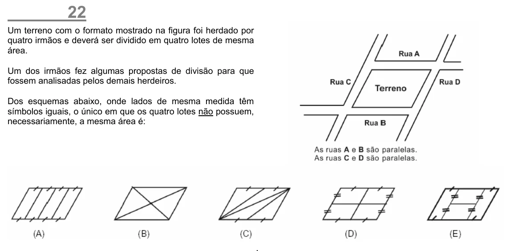

Texto extraído (pode conter ruído)

22  
Um terreno com o formato mostrado na figura foi herdado por  
quatro irmãos e deverá ser dividido em quatro lotes de mesma  
área.  
Um dos irmãos fez algumas propostas de divisão para que  
fossem analisadas pelos demais herdeiros.  
Dos esquemas abaixo, onde lados de mesma medida têm  
símbolos iguais, o único em que os quatro lotes não possuem,  
necessariamente, a mesma área é:

