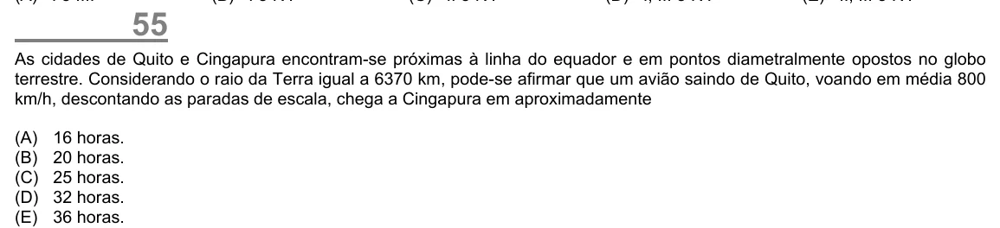

Texto extraído (pode conter ruído)

55  
As cidades de Quito e Cingapura encontram-se próximas à linha do equador e em pontos diametralmente opostos no globo  
terrestre. Considerando o raio da Terra igual a 6370 km, pode-se afirmar que um avião saindo de Quito, voando em média 800  
km/h, descontando as paradas de escala, chega a Cingapura em aproximadamente  
(A)  
16 horas.  
(B)  
20 horas.  
(C)  
25 horas.  
(D)  
32 horas.  
(E)  
36 horas.

