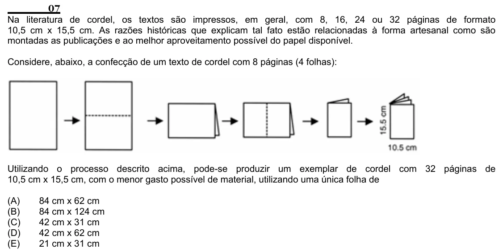

Texto extraído (pode conter ruído)

07  
Na literatura de cordel, os textos são impressos, em geral, com 8, 16, 24 ou 32 páginas de formato  
10,5 cm x 15,5 cm. As razões históricas que explicam tal fato estão relacionadas à forma artesanal como são  
montadas as publicações e ao melhor aproveitamento possível do papel disponível.  
Considere, abaixo, a confecção de um texto de cordel com 8 páginas (4 folhas):  
Utilizando o processo descrito acima, pode-se produzir um exemplar de cordel com 32 páginas de  
10,5 cm x 15,5 cm, com o menor gasto possível de material, utilizando uma única folha de  
(A)  
84 cm x 62 cm  
(B)  
84 cm x 124 cm  
(C)  
42 cm x 31 cm  
(D)  
42 cm x 62 cm  
(E)  
21 cm x 31 cm

