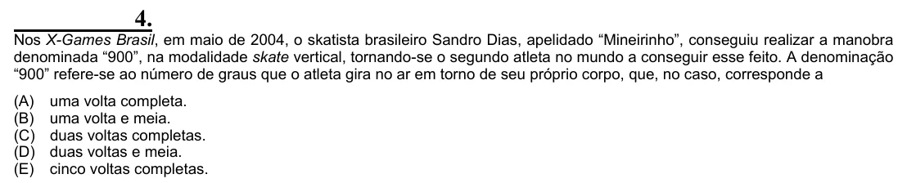

Texto extraído (pode conter ruído)

4.  
Nos X-Games Brasil, em maio de 2004, o skatista brasileiro Sandro Dias, apelidado “Mineirinho”, conseguiu realizar a manobra  
denominada “900”, na modalidade skate vertical, tornando-se o segundo atleta no mundo a conseguir esse feito. A denominação  
“900” refere-se ao número de graus que o atleta gira no ar em torno de seu próprio corpo, que, no caso, corresponde a  
(A)  
uma volta completa.  
(B)  
uma volta e meia.  
(C)  
duas voltas completas.  
(D)  
duas voltas e meia.  
(E)  
cinco voltas completas.

