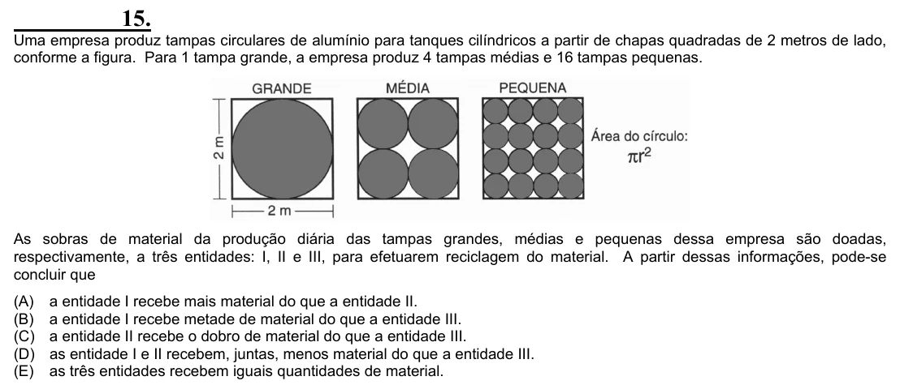

Texto extraído (pode conter ruído)

15.  
Uma empresa produz tampas circulares de alumínio para tanques cilíndricos a partir de chapas quadradas de 2 metros de lado,  
conforme a figura. Para 1 tampa grande, a empresa produz 4 tampas médias e 16 tampas pequenas.  
As sobras de material da produção diária das tampas grandes, médias e pequenas dessa empresa são doadas,  
respectivamente, a três entidades: I, II e III, para efetuarem reciclagem do material. A partir dessas informações, pode-se  
concluir que  
(A)  
a entidade I recebe mais material do que a entidade II.  
(B)  
a entidade I recebe metade de material do que a entidade III.  
(C)  
a entidade II recebe o dobro de material do que a entidade III.  
(D)  
as entidade I e II recebem, juntas, menos material do que a entidade III.  
(E)  
as três entidades recebem iguais quantidades de material.

