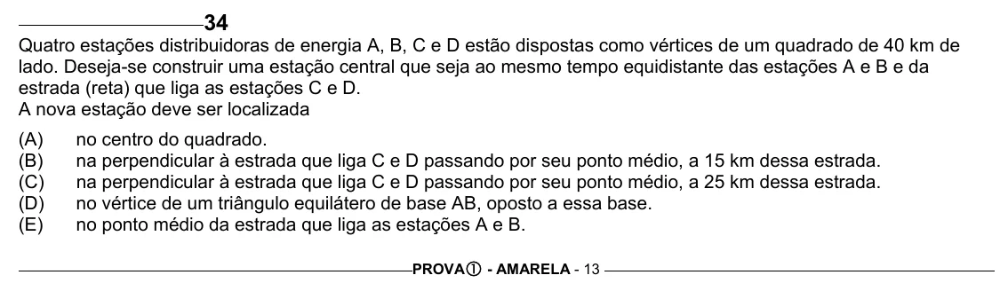

Texto extraído (pode conter ruído)

34  
Quatro estações distribuidoras de energia A, B, C e D estão dispostas como vértices de um quadrado de 40 km de  
lado. Deseja-se construir uma estação central que seja ao mesmo tempo equidistante das estações A e B e da  
estrada (reta) que liga as estações C e D.  
A nova estação deve ser localizada  
(A)  
no centro do quadrado.  
(B)  
na perpendicular à estrada que liga C e D passando por seu ponto médio, a 15 km dessa estrada.  
(C)  
na perpendicular à estrada que liga C e D passando por seu ponto médio, a 25 km dessa estrada.  
(D)  
no vértice de um triângulo equilátero de base AB, oposto a essa base.  
(E)  
no ponto médio da estrada que liga as estações A e B.  
PROVA c - AMARELA - 13

