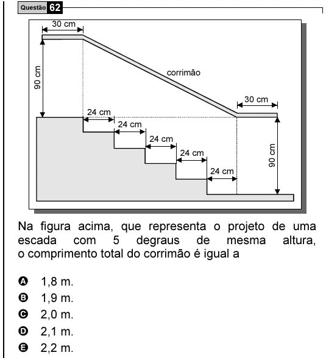

Texto extraído (pode conter ruído)

Questão 62  
30 cm  
90 cm  
corrimão  
30 cm  
24 cm  
24 cm  
24 cm  
90 cm  
24 cm  
24 cm  
Na figura acima, que representa o projeto de uma  
escada com 5 degraus de mesma altura,  
o comprimento total do corrimão é igual a  
A  
1,8 m.  
B  
1,9 m.  
C  
2,0 m.  
D  
2,1 m.  
E  
2,2 m.

