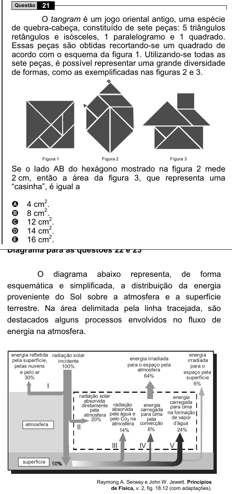

Texto extraído (pode conter ruído)

Questão  
21  
O tangram é um jogo oriental antigo, uma espécie  
de quebra-cabeça, constituído de sete peças: 5 triângulos  
retângulos e isósceles, 1 paralelogramo e 1 quadrado.  
Essas peças são obtidas recortando-se um quadrado de  
acordo com o esquema da figura 1. Utilizando-se todas as  
sete peças, é possível representar uma grande diversidade  
de formas, como as exemplificadas nas figuras 2 e 3.  
B  
A  
Figura 1  
Figura 2  
Figura 3  
Se o lado AB do hexágono mostrado na figura 2 mede  
2 cm, então a área da figura 3, que representa uma  
“casinha”, é igual a  
4 cm 2 .  
A  
8 cm 2 .  
B  
12 cm 2 .  
C  
14 cm 2 .  
D  
16 cm 2 .  
E  
O diagrama abaixo representa, de forma  
esquemática e simplificada, a distribuição da energia  
proveniente do Sol sobre a atmosfera e a superfície  
terrestre. Na área delimitada pela linha tracejada, são  
destacados alguns processos envolvidos no fluxo de  
energia na atmosfera.  
energia refletida radiação solar  
energia  
energia irradiada  
pela superfície,  
incidente  
irradiada  
para o espaço pela  
pelas nuvens  
100%  
para o  
atmosfera  
e pelo ar  
espaço pela  
64%  
30%  
superfície  
I  
6%  
radiação solar  
energia  
absorvida  
carregada  
diretamente radiação  
energia  
absorvida carregada  
para  
cima  
pela  
atmosfera pela água e para cima na formação  
20%  
pelo Co 2 na  
pela  
de  
vapor  
atmosfera  
atmosfera convecção  
d’água  
II  
6%  
24%  
14%  
III  
IV  
V  
superfície  
Raymong A. Serway e John W. Jewett. Princípios  
de Física, v. 2, fig. 18.12 (com adaptações).

