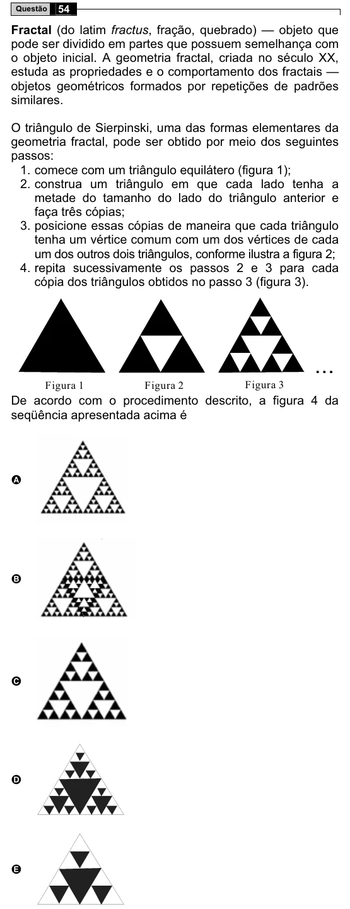

Texto extraído (pode conter ruído)

54  
Questão  
Fractal (do latim fractus, fração, quebrado) — objeto que  
pode ser dividido em partes que possuem semelhança com  
o objeto inicial. A geometria fractal, criada no século XX,  
estuda as propriedades e o comportamento dos fractais —  
objetos geométricos formados por repetições de padrões  
similares.  
O triângulo de Sierpinski, uma das formas elementares da  
geometria fractal, pode ser obtido por meio dos seguintes  
passos:  
1. comece com um triângulo equilátero (figura 1);  
2. construa um triângulo em que cada lado tenha a  
metade do tamanho do lado do triângulo anterior e  
faça três cópias;  
3. posicione essas cópias de maneira que cada triângulo  
tenha um vértice comum com um dos vértices de cada  
um dos outros dois triângulos, conforme ilustra a figura 2;  
4. repita sucessivamente os passos 2 e 3 para cada  
cópia dos triângulos obtidos no passo 3 (figura 3).  
...  
Figura 1  
Figura 2  
Figura 3  
De acordo com o procedimento descrito, a figura 4 da  
seqüência apresentada acima é  
A  
B  
C  
D  
E

