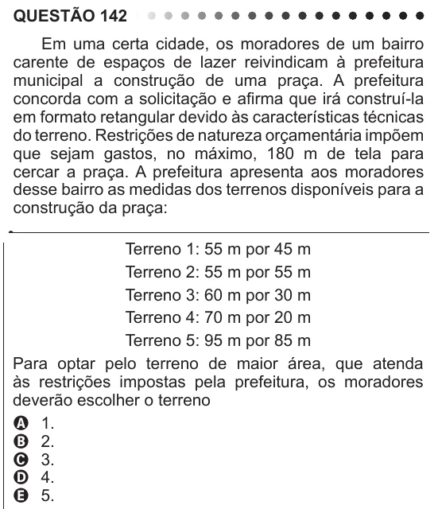

Texto extraído (pode conter ruído)

QUESTÃO 142  
Em uma certa cidade, os moradores de um bairro  
carente de espaços de lazer reivindicam à prefeitura  
municipal a construção de uma praça. A prefeitura  
concorda com a solicitação e afirma que irá construí-la  
em formato retangular devido às características técnicas  
do terreno. Restrições de natureza orçamentária impõem  
que sejam gastos, no máximo, 180 m de tela para  
cercar a praça. A prefeitura apresenta aos moradores  
desse bairro as medidas dos terrenos disponíveis para a  
construção da praça:  
Terreno 1: 55 m por 45 m  
Terreno 2: 55 m por 55 m  
Terreno 3: 60 m por 30 m  
Terreno 4: 70 m por 20 m  
Terreno 5: 95 m por 85 m  
Para optar pelo terreno de maior área, que atenda  
às restrições impostas pela prefeitura, os moradores  
deverão escolher o terreno  
A 1.  
B 2.  
C 3.  
D 4.  
E 5.

