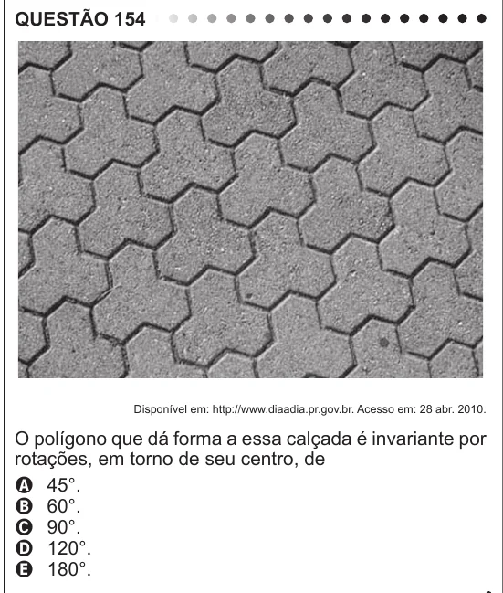

Texto extraído (pode conter ruído)

QUESTÃO 154  
Disponível em: http://www.diaadia.pr.gov.br. Acesso em: 28 abr. 2010.  
O polígono que dá forma a essa calçada é invariante por  
rotações, em torno de seu centro, de  
A 45°.  
B 60°.  
C 90°.  
D 120°.  
E 180°.

