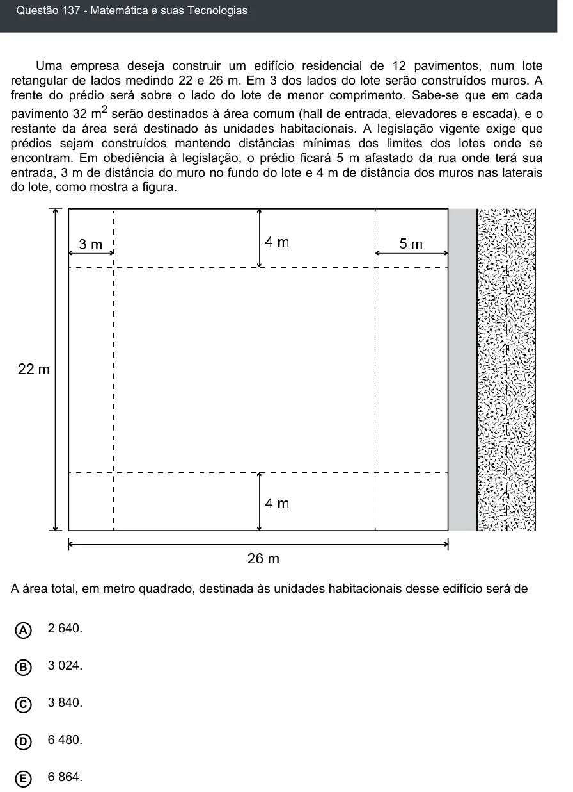

Texto extraído (pode conter ruído)

Questão 137 - Matemática e suas Tecnologias  
Uma empresa deseja construir um edifício residencial de 12 pavimentos, num lote  
retangular de lados medindo 22 e 26 m. Em 3 dos lados do lote serão construídos muros. A  
frente do prédio será sobre o lado do lote de menor comprimento. Sabe-se que em cada  
pavimento 32 m 2 serão destinados à área comum (hall de entrada, elevadores e escada), e o  
restante da área será destinado às unidades habitacionais. A legislação vigente exige que  
prédios sejam construídos mantendo distâncias mínimas dos limites dos lotes onde se  
encontram. Em obediência à legislação, o prédio ficará 5 m afastado da rua onde terá sua  
entrada, 3 m de distância do muro no fundo do lote e 4 m de distância dos muros nas laterais  
do lote, como mostra a figura.  
A área total, em metro quadrado, destinada às unidades habitacionais desse edifício será de  
2 640.  
A  
3 024.  
B  
C  
3 840.  
6 480.  
D  
6 864.  
E

