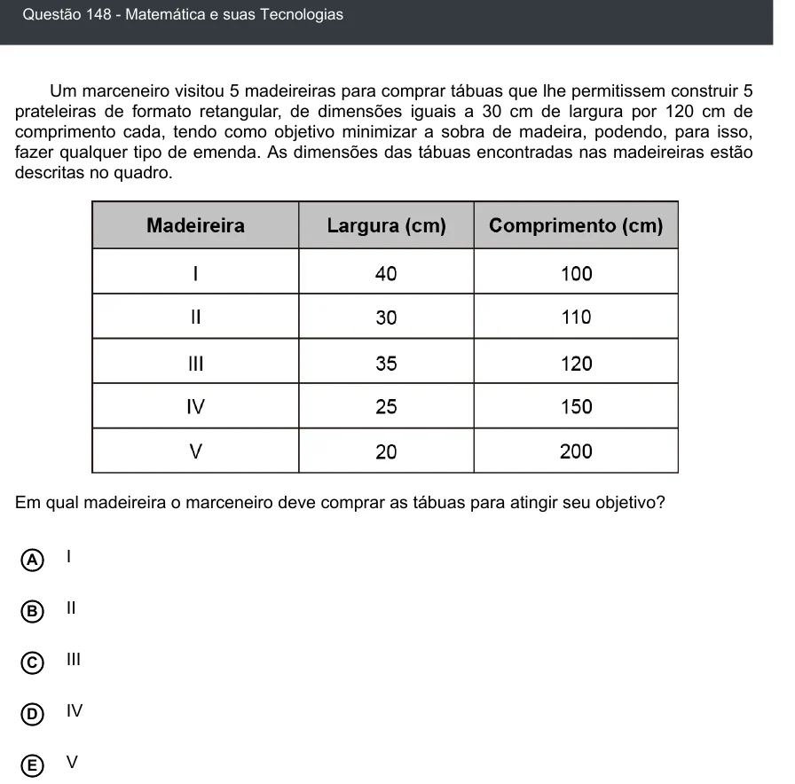

Texto extraído (pode conter ruído)

Questão 148 - Matemática e suas Tecnologias  
Um marceneiro visitou 5 madeireiras para comprar tábuas que lhe permitissem construir 5  
prateleiras de formato retangular, de dimensões iguais a 30 cm de largura por 120 cm de  
comprimento cada, tendo como objetivo minimizar a sobra de madeira, podendo, para isso,  
fazer qualquer tipo de emenda. As dimensões das tábuas encontradas nas madeireiras estão  
descritas no quadro.  
Em qual madeireira o marceneiro deve comprar as tábuas para atingir seu objetivo?  
I  
A  
II  
B  
III  
C  
D  
IV  
V  
E

