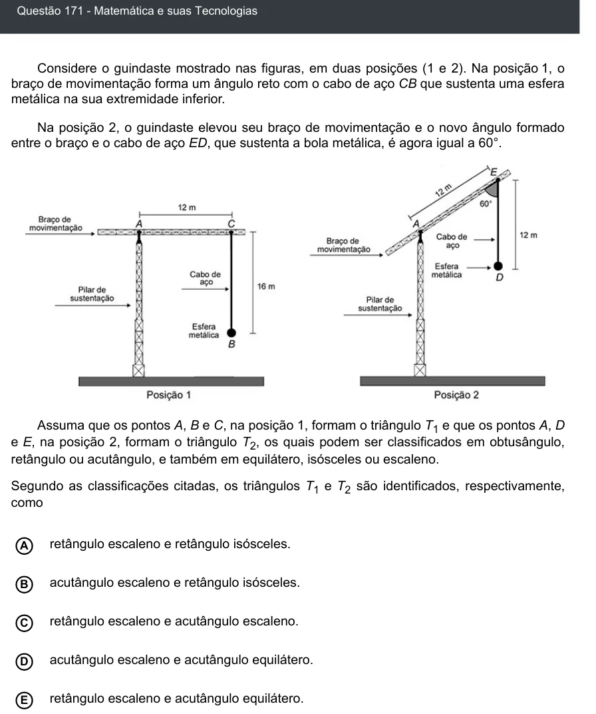

Texto extraído (pode conter ruído)

Questão 171 - Matemática e suas Tecnologias  
Considere o guindaste mostrado nas figuras, em duas posições (1 e 2). Na posição 1, o  
braço de movimentação forma um ângulo reto com o cabo de aço CB que sustenta uma esfera  
metálica na sua extremidade inferior.  
Na posição 2, o guindaste elevou seu braço de movimentação e o novo ângulo formado  
entre o braço e o cabo de aço ED, que sustenta a bola metálica, é agora igual a 60°.  
Assuma que os pontos A, B e C, na posição 1, formam o triângulo T 1 e que os pontos A, D  
e E, na posição 2, formam o triângulo T 2 , os quais podem ser classificados em obtusângulo,  
retângulo ou acutângulo, e também em equilátero, isósceles ou escaleno.  
Segundo as classificações citadas, os triângulos T 1 e T 2 são identificados, respectivamente,  
como  
retângulo escaleno e retângulo isósceles.  
A  
acutângulo escaleno e retângulo isósceles.  
B  
C  
retângulo escaleno e acutângulo escaleno.  
D  
acutângulo escaleno e acutângulo equilátero.  
retângulo escaleno e acutângulo equilátero.  
E

