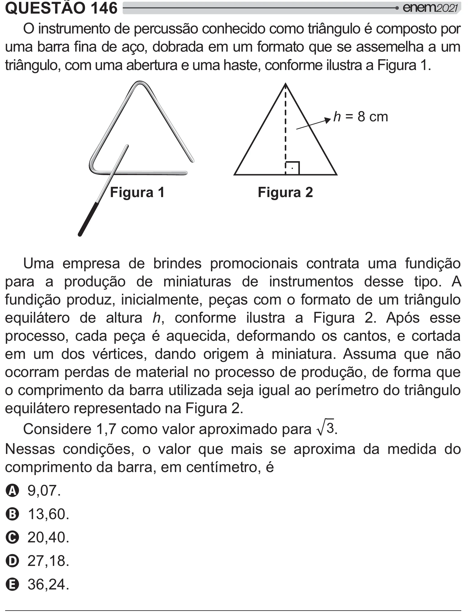

Texto extraído (pode conter ruído)

QUESTÃO 146  
O instrumento de percussão conhecido como triângulo é composto por  
y =y  >   
   $   
triângulo, com uma abertura e uma haste, conforme ilustra a Figura 1.  
h = 8 cm  
Figura 1  
Figura 2  
Uma empresa de brindes promocionais contrata uma fundição  
para a produção de miniaturas de instrumentos desse tipo. A  
fundição produz, inicialmente, peças com o formato de um triângulo  
equilátero de altura h, conforme ilustra a Figura 2. Após esse  
processo, cada peça é aquecida, deformando os cantos, e cortada  
em um dos vértices, dando origem à miniatura. Assuma que não  
ocorram perdas de material no processo de produção, de forma que  
o comprimento da barra utilizada seja igual ao perímetro do triângulo  
equilátero representado na Figura 2.  
Considere 1,7 como valor aproximado para ® .  
Nessas condições, o valor que mais se aproxima da medida do  
comprimento da barra, em centímetro, é  
A 9,07.  
B 13,60.  
C 20,40.  
D 27,18.  
E 36,24.

