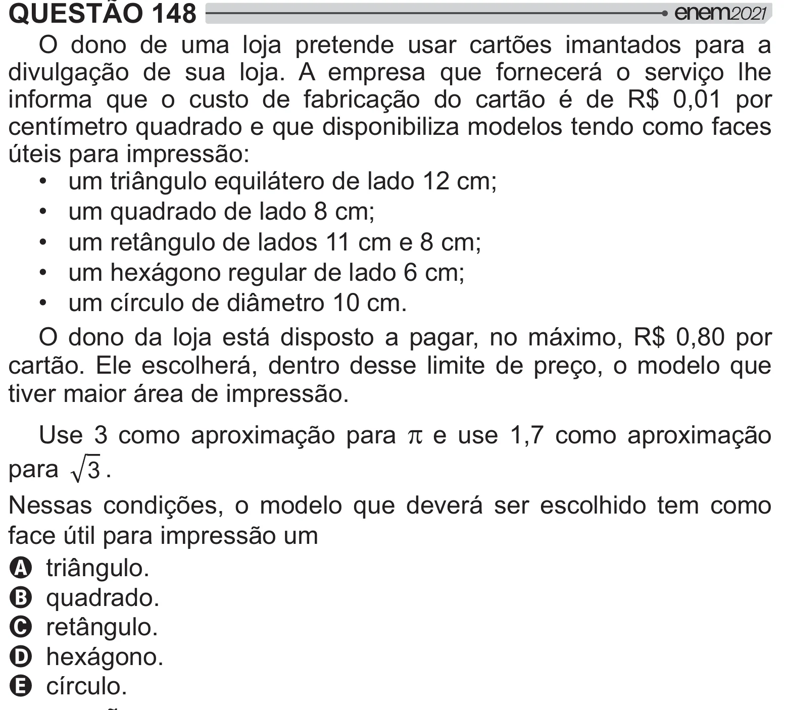

Texto extraído (pode conter ruído)

QUESTÃO 148  
O dono de uma loja pretende usar cartões imantados para a  
divulgação de sua loja. A empresa que fornecerá o serviço lhe  
informa que o custo de fabricação do cartão é de R$ 0,01 por  
centímetro quadrado e que disponibiliza modelos tendo como faces  
úteis para impressão:  
• um triângulo equilátero de lado 12 cm;  
• um quadrado de lado 8 cm;  
• um retângulo de lados 11 cm e 8 cm;  
• um hexágono regular de lado 6 cm;  
• um círculo de diâmetro 10 cm.  
O dono da loja está disposto a pagar, no máximo, R$ 0,80 por  
cartão. Ele escolherá, dentro desse limite de preço, o modelo que  
tiver maior área de impressão.  
Use 3 como aproximação para S  e use 1,7 como aproximação  
para ® .  
Nessas condições, o modelo que deverá ser escolhido tem como  
face útil para impressão um  
A triângulo.  
B quadrado.  
C retângulo.  
D hexágono.  
E círculo.

