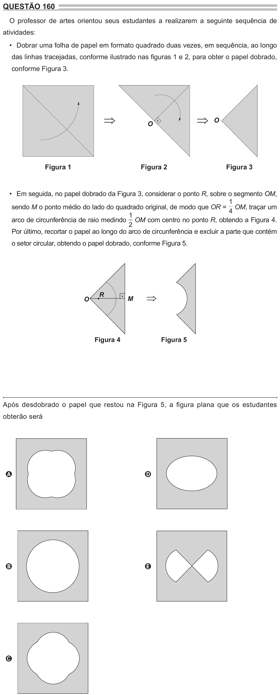

Texto extraído (pode conter ruído)

QUESTÃO 160  
O professor de artes orientou seus estudantes a realizarem a seguinte sequência de  
atividades:  
• Dobrar uma folha de papel em formato quadrado duas vezes, em sequência, ao longo  
das linhas tracejadas, conforme ilustrado nas figuras 1 e 2, para obter o papel dobrado,  
conforme Figura 3.  
  
 O  
O  
Figura 1  
Figura 2  
Figura 3  
• Em seguida, no papel dobrado da Figura 3, considerar o ponto R, sobre o segmento OM,  
1  
sendo M o ponto médio do lado do quadrado original, de modo que OR = OM, traçar um  
4  
1  
arco de circunferência de raio medindo OM com centro no ponto R, obtendo a Figura 4.  
2  
Por último, recortar o papel ao longo do arco de circunferência e excluir a parte que contém  
o setor circular, obtendo o papel dobrado, conforme Figura 5.  
R  
⇒  
O  
M  
Figura 4  
Figura 5  
Após desdobrado o papel que restou na Figura 5, a figura plana que os estudantes  
obterão será  
A  
D  
B  
E  
C

