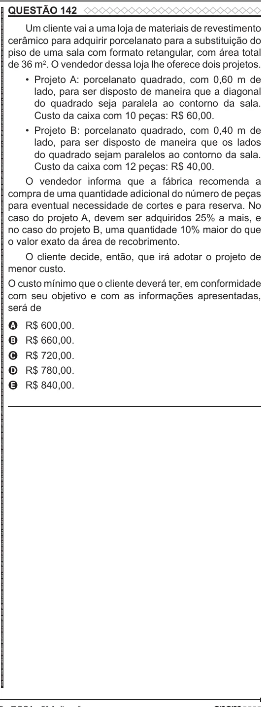

Texto extraído (pode conter ruído)

QUESTÃO 142  
ENEM 2022 ENEM 2022 ENEM 2022 ENEM 2022 ENEM 2022 ENEM 2022 ENEM 2022 ENEM 2022 ENEM 2022 ENEM 2022 ENEM 2022 ENEM 2022 ENEM 2022 ENEM 2022 ENEM 2022 ENEM 2022 ENEM 2022 ENEM 2022 ENEM 2022 ENEM 2022 ENEM 2022 ENEM 2022 ENEM 2022 ENEM 2022 ENEM 2022 ENEM 2022 ENEM 2022 ENEM 2022 ENEM 2022 ENEM 2022 ENEM 2022 ENEM 2022 ENEM 2022 ENEM 2022 ENEM 2022 ENEM 2022 ENEM 2022 ENEM 2022 ENEM 2022 ENEM 2022 ENEM 2022 ENEM 2022 ENEM 2022 ENEM 2022 ENEM 2022 ENEM 2022 ENEM 2022 ENEM 2022 ENEM 2022 ENEM 2022 ENEM 2022 ENEM 2022 ENEM 2022 ENEM 2022 ENEM 2022 ENEM 2022 ENEM 2022 ENEM 2022 ENEM 2022 ENEM 2022 ENEM 2022 ENEM 2022 ENEM 2022  
Um cliente vai a uma loja de materiais de revestimento  
cerâmico para adquirir porcelanato para a substituição do  
piso de uma sala com formato retangular, com área total  
de 36 m 2 . O vendedor dessa loja lhe oferece dois projetos.  
• Projeto A: porcelanato quadrado, com 0,60 m de  
lado, para ser disposto de maneira que a diagonal  
do quadrado seja paralela ao contorno da sala.  
Custo da caixa com 10 peças: R$ 60,00.  
• Projeto B: porcelanato quadrado, com 0,40 m de  
lado, para ser disposto de maneira que os lados  
do quadrado sejam paralelos ao contorno da sala.  
Custo da caixa com 12 peças: R$ 40,00.  
O vendedor informa que a fábrica recomenda a  
compra de uma quantidade adicional do número de peças  
para eventual necessidade de cortes e para reserva. No  
caso do projeto A, devem ser adquiridos 25% a mais, e  
no caso do projeto B, uma quantidade 10% maior do que  
o valor exato da área de recobrimento.  
O cliente decide, então, que irá adotar o projeto de  
menor custo.  
O custo mínimo que o cliente deverá ter, em conformidade  
com seu objetivo e com as informações apresentadas,  
será de  
R$ 600,00.  
A  
B  
R$ 660,00.  
R$ 720,00.  
C  
R$ 780,00.  
D  
R$ 840,00.  
E

