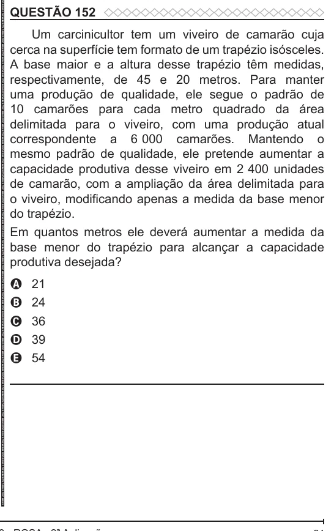

Texto extraído (pode conter ruído)

QUESTÃO 152  
Um carcinicultor tem um viveiro de camarão cuja  
cerca na superfície tem formato de um trapézio isósceles.  
A base maior e a altura desse trapézio têm medidas,  
respectivamente, de 45 e 20 metros. Para manter  
uma produção de qualidade, ele segue o padrão de  
10 camarões para cada metro quadrado da área  
delimitada para o viveiro, com uma produção atual  
correspondente a 6 000 camarões. Mantendo o  
mesmo padrão de qualidade, ele pretende aumentar a  
capacidade produtiva desse viveiro em 2 400 unidades  
de camarão, com a ampliação da área delimitada para  
o viveiro, modificando apenas a medida da base menor  
do trapézio.  
Em quantos metros ele deverá aumentar a medida da  
base menor do trapézio para alcançar a capacidade  
produtiva desejada?  
21  
A  
24  
B  
C  
36  
D  
39  
54  
E

