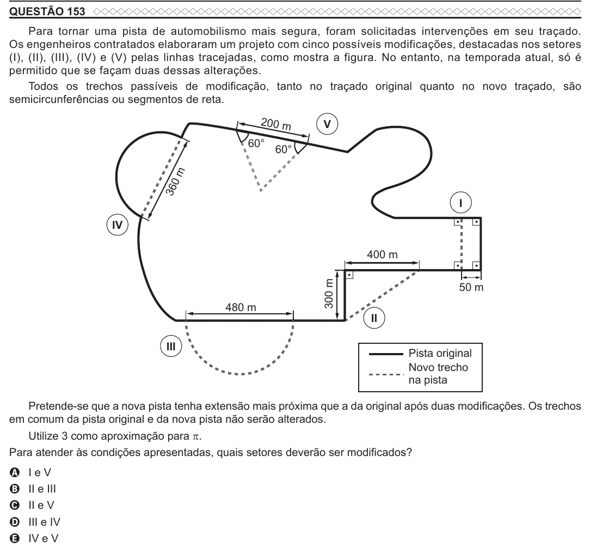

Texto extraído (pode conter ruído)

QUESTÃO 153  
Para tornar uma pista de automobilismo mais segura, foram solicitadas intervenções em seu traçado.  
Os engenheiros contratados elaboraram um projeto com cinco possíveis modificações, destacadas nos setores  
(I), (II), (III), (IV) e (V) pelas linhas tracejadas, como mostra a figura. No entanto, na temporada atual, só é  
permitido que se façam duas dessas alterações.  
Todos os trechos passíveis de modificação, tanto no traçado original quanto no novo traçado, são  
semicircunferências ou segmentos de reta.  
200 m  
V  
60°  
60°  
m  
360  
I  
IV  
400 m  
300 m  
50 m  
480 m  
II  
III  
Pista original  
Novo trecho  
na pista  
Pretende-se que a nova pista tenha extensão mais próxima que a da original após duas modificações. Os trechos  
em comum da pista original e da nova pista não serão alterados.  
Utilize 3 como aproximação para π .  
Para atender às condições apresentadas, quais setores deverão ser modificados?  
I e V  
A  
II e III  
B  
C  
II e V  
D  
III e IV  
IV e V  
E

