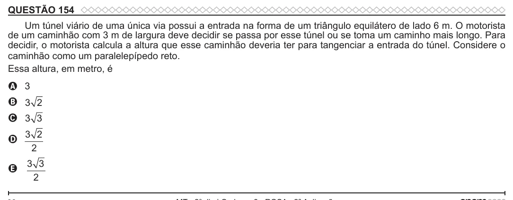

Texto extraído (pode conter ruído)

QUESTÃO 154  
Um túnel viário de uma única via possui a entrada na forma de um triângulo equilátero de lado 6 m. O motorista  
de um caminhão com 3 m de largura deve decidir se passa por esse túnel ou se toma um caminho mais longo. Para  
decidir, o motorista calcula a altura que esse caminhão deveria ter para tangenciar a entrada do túnel. Considere o  
caminhão como um paralelepípedo reto.  
Essa altura, em metro, é  
A 3  
B 3 2  
C 3 3  
3 2  
D  
2  
3 3  
E  
2

