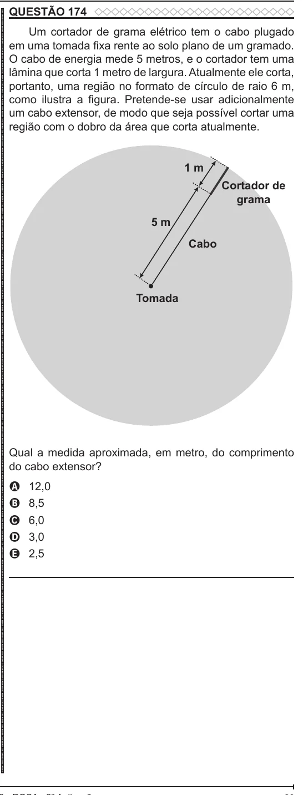

Texto extraído (pode conter ruído)

QUESTÃO 174  
ENEM 2022 ENEM 2022 ENEM 2022 ENEM 2022 ENEM 2022 ENEM 2022 ENEM 2022 ENEM 2022 ENEM 2022 ENEM 2022 ENEM 2022 ENEM 2022 ENEM 2022 ENEM 2022 ENEM 2022 ENEM 2022 ENEM 2022 ENEM 2022 ENEM 2022 ENEM 2022 ENEM 2022 ENEM 2022 ENEM 2022 ENEM 2022 ENEM 2022 ENEM 2022 ENEM 2022 ENEM 2022 ENEM 2022 ENEM 2022 ENEM 2022 ENEM 2022 ENEM 2022 ENEM 2022 ENEM 2022 ENEM 2022 ENEM 2022 ENEM 2022 ENEM 2022 ENEM 2022 ENEM 2022 ENEM 2022 ENEM 2022 ENEM 2022 ENEM 2022 ENEM 2022 ENEM 2022 ENEM 2022 ENEM 2022 ENEM 2022 ENEM 2022 ENEM 2022 ENEM 2022 ENEM 2022 ENEM 2022 ENEM 2022 ENEM 2022 ENEM 2022 ENEM 2022 ENEM 2022 ENEM 2022 ENEM 2022 ENEM 2022  
Um cortador de grama elétrico tem o cabo plugado  
em uma tomada fixa rente ao solo plano de um gramado.  
O cabo de energia mede 5 metros, e o cortador tem uma  
lâmina que corta 1 metro de largura. Atualmente ele corta,  
portanto, uma região no formato de círculo de raio 6 m,  
como ilustra a figura. Pretende-se usar adicionalmente  
um cabo extensor, de modo que seja possível cortar uma  
região com o dobro da área que corta atualmente.  
1 m  
Cortador de  
grama  
5 m  
Cabo  
Tomada  
Qual a medida aproximada, em metro, do comprimento  
do cabo extensor?  
12,0  
A  
8,5  
B  
6,0  
C  
3,0  
D  
2,5  
E

