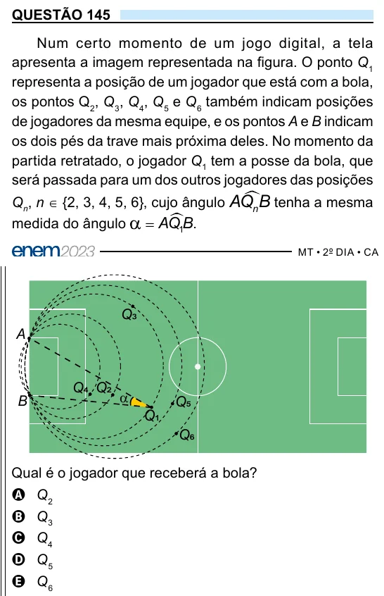

Texto extraído (pode conter ruído)

QUESTÃO 145  
Num certo momento de um jogo digital, a tela  
apresenta a imagem representada na figura. O ponto Q 1  
representa a posição de um jogador que está com a bola,  
os pontos Q 2 , Q 3 , Q 4 , Q 5 e Q 6 também indicam posições  
de jogadores da mesma equipe, e os pontos A e B indicam  
os dois pés da trave mais próxima deles. No momento da  
partida retratado, o jogador Q 1 tem a posse da bola, que  
será passada para um dos outros jogadores das posições  
Q n , n ∈ {2, 3, 4, 5, 6}, cujo ângulo AQ n B tenha a mesma  
medida do ângulo  
AQ 1 B .  
Q3  
A  
Q4 Q2  
α  
B  
Q5  
Q1  
Q6  
Qual é o jogador que receberá a bola?  
A Q 2  
B Q 3  
C Q 4  
D Q 5  
E Q 6

