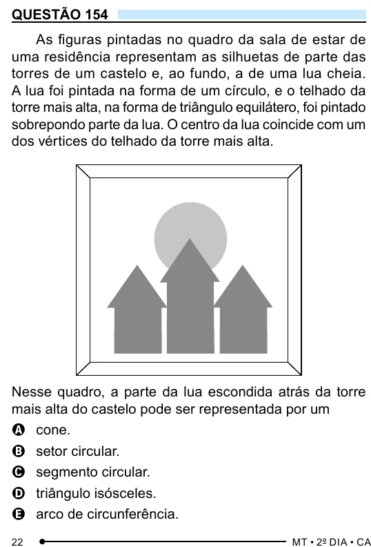

Texto extraído (pode conter ruído)

QUESTÃO 154  
As figuras pintadas no quadro da sala de estar de  
uma residência representam as silhuetas de parte das  
torres de um castelo e, ao fundo, a de uma lua cheia.  
A lua foi pintada na forma de um círculo, e o telhado da  
torre mais alta, na forma de triângulo equilátero, foi pintado  
sobrepondo parte da lua. O centro da lua coincide com um  
dos vértices do telhado da torre mais alta.  
Nesse quadro, a parte da lua escondida atrás da torre  
mais alta do castelo pode ser representada por um  
A cone.  
B setor circular.  
C segmento circular.  
D triângulo isósceles.  
E arco de circunferência.

