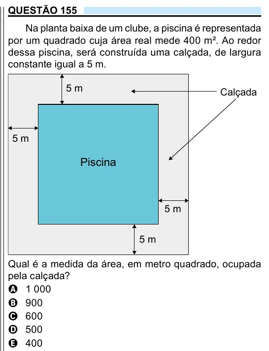

Texto extraído (pode conter ruído)

QUESTÃO 155  
Na planta baixa de um clube, a piscina é representada  
por um quadrado cuja área real mede 400 m². Ao redor  
dessa piscina, será construída uma calçada, de largura  
constante igual a 5 m.  
5 m  
Calçada  
5 m  
Piscina  
5 m  
5 m  
Qual é a medida da área, em metro quadrado, ocupada  
pela calçada?  
A 1 000  
B 900  
C 600  
D 500  
E 400

