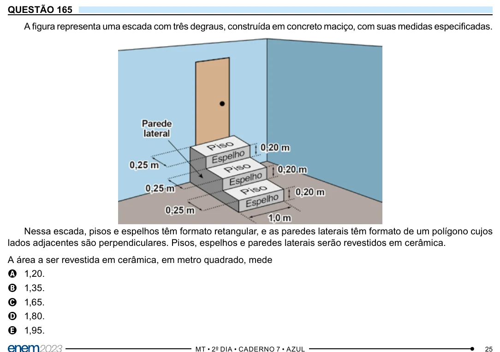

Texto extraído (pode conter ruído)

QUESTÃO 165  
A figura representa uma escada com três degraus, construída em concreto maciço, com suas medidas especificadas.  
Nessa escada, pisos e espelhos têm formato retangular, e as paredes laterais têm formato de um polígono cujos  
lados adjacentes são perpendiculares. Pisos, espelhos e paredes laterais serão revestidos em cerâmica.  
A área a ser revestida em cerâmica, em metro quadrado, mede  
A 1,20.  
B 1,35.  
C 1,65.  
D 1,80.  
E 1,95.

