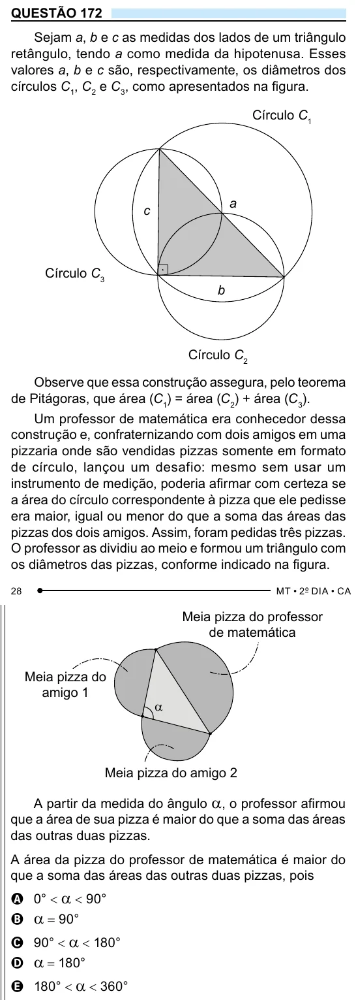

Texto extraído (pode conter ruído)

QUESTÃO 172  
Sejam a, b e c as medidas dos lados de um triângulo  
retângulo, tendo a como medida da hipotenusa. Esses E 180° < a < 360°  
valores a, b e c são, respectivamente, os diâmetros dos  
círculos C 1 , C 2 e C 3 , como apresentados na figura.  
Círculo C 1  
a  
c  
Círculo C 3  
b  
Círculo C 2  
Observe que essa construção assegura, pelo teorema  
de Pitágoras, que área (C 1 ) = área (C 2 ) + área (C 3 ).  
Um professor de matemática era conhecedor dessa  
construção e, confraternizando com dois amigos em uma  
pizzaria onde são vendidas pizzas somente em formato  
de círculo, lançou um desafio: mesmo sem usar um  
instrumento de medição, poderia afirmar com certeza se  
a área do círculo correspondente à pizza que ele pedisse  
era maior, igual ou menor do que a soma das áreas das  
pizzas dos dois amigos. Assim, foram pedidas três pizzas.  
O professor as dividiu ao meio e formou um triângulo com  
os diâmetros das pizzas, conforme indicado na figura.  
Meia pizza do professor  
de matemática  
Meia pizza do  
amigo 1  
α  
Meia pizza do amigo 2  
A partir da medida do ângulo a , o professor afirmou  
que a área de sua pizza é maior do que a soma das áreas  
das outras duas pizzas.  
A área da pizza do professor de matemática é maior do  
que a soma das áreas das outras duas pizzas, pois  
A 0° < a < 90°  
a = 90°  
B  
C 90° < a < 180°  
D a = 180°

