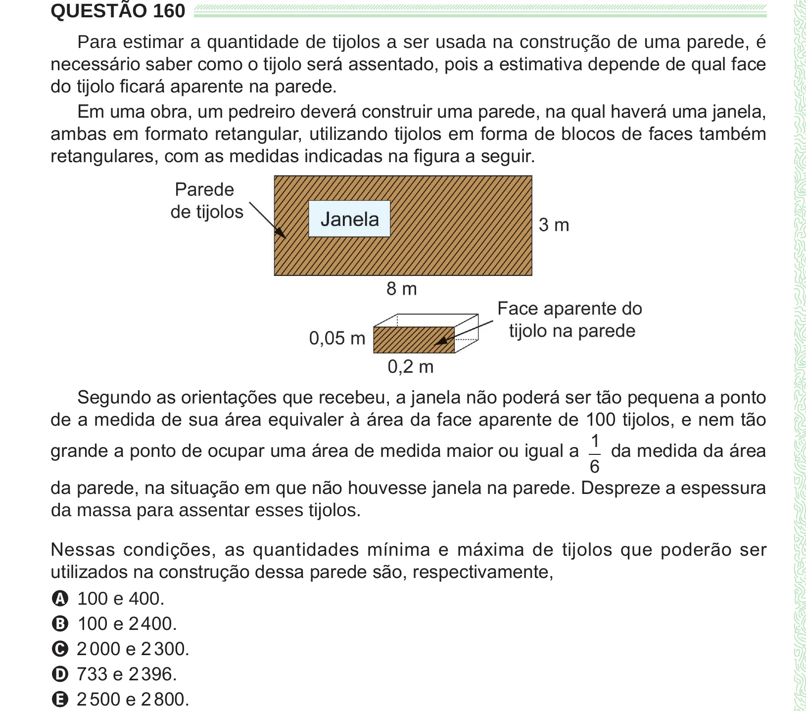

Texto extraído (pode conter ruído)

QUESTÃO 160  
Para estimar a quantidade de tijolos a ser usada na construção de uma parede, é  
necessário saber como o tijolo será assentado, pois a estimativa depende de qual face  
do tijolo ficará aparente na parede.  
Em uma obra, um pedreiro deverá construir uma parede, na qual haverá uma janela,  
ambas em formato retangular, utilizando tijolos em forma de blocos de faces também  
retangulares, com as medidas indicadas na figura a seguir.  
Segundo as orientações que recebeu, a janela não poderá ser tão pequena a ponto  
de a medida de sua área equivaler à área da face aparente de 100 tijolos, e nem tão  
1  
grande a ponto de ocupar uma área de medida maior ou igual a  
da medida da área  
6  
da parede, na situação em que não houvesse janela na parede. Despreze a espessura  
da massa para assentar esses tijolos.  
Nessas condições, as quantidades mínima e máxima de tijolos que poderão ser  
utilizados na construção dessa parede são, respectivamente,  
A 100 e 400.  
B 100 e 2 400.  
C 2 000 e 2 300.  
D 733 e 2 396.  
E 2 500 e 2 800.

