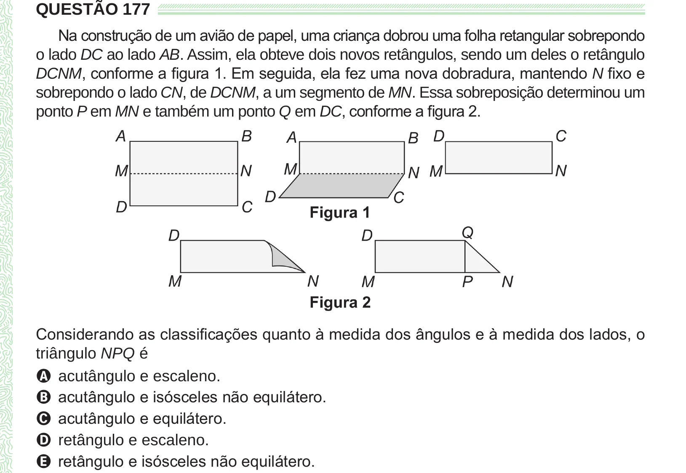

Texto extraído (pode conter ruído)

QUESTÃO 177  
Na construção de um avião de papel, uma criança dobrou uma folha retangular sobrepondo  
o lado DC ao lado AB. Assim, ela obteve dois novos retângulos, sendo um deles o retângulo  
DCNM, conforme a figura 1. Em seguida, ela fez uma nova dobradura, mantendo N fixo e  
sobrepondo o lado CN, de DCNM, a um segmento de MN. Essa sobreposição determinou um  
ponto P em MN e também um ponto Q em DC, conforme a figura 2.  
Considerando as classificações quanto à medida dos ângulos e à medida dos lados, o  
triângulo NPQ é  
A acutângulo e escaleno.  
B acutângulo e isósceles não equilátero.  
C acutângulo e equilátero.  
D retângulo e escaleno.  
E retângulo e isósceles não equilátero.

