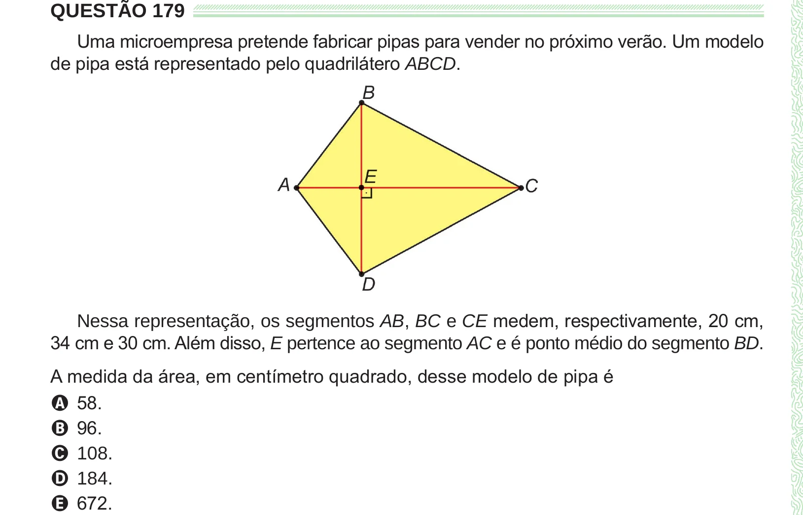

Texto extraído (pode conter ruído)

QUESTÃO 179  
Uma microempresa pretende fabricar pipas para vender no próximo verão. Um modelo  
de pipa está representado pelo quadrilátero ABCD.  
Nessa representação, os segmentos AB, BC e CE medem, respectivamente, 20 cm,  
34 cm e 30 cm. Além disso, E pertence ao segmento AC e é ponto médio do segmento BD.  
A medida da área, em centímetro quadrado, desse modelo de pipa é  
A 58.  
B 96.  
C 108.  
D 184.  
E 672.

