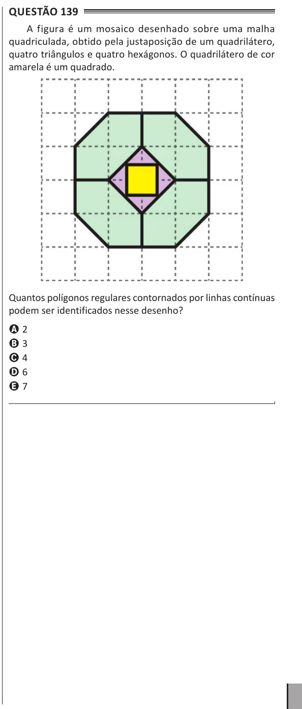

Texto extraído (pode conter ruído)

Questão 139  
A figura é um mosaico desenhado sobre uma malha  
quadriculada, obtido pela justaposição de um quadrilátero,  
quatro triângulos e quatro hexágonos. O quadrilátero de cor  
amarela é um quadrado.  
Quantos polígonos regulares contornados por linhas contínuas  
podem ser identificados nesse desenho?  
A 2  
B 3  
C 4  
D 6  
E 7

