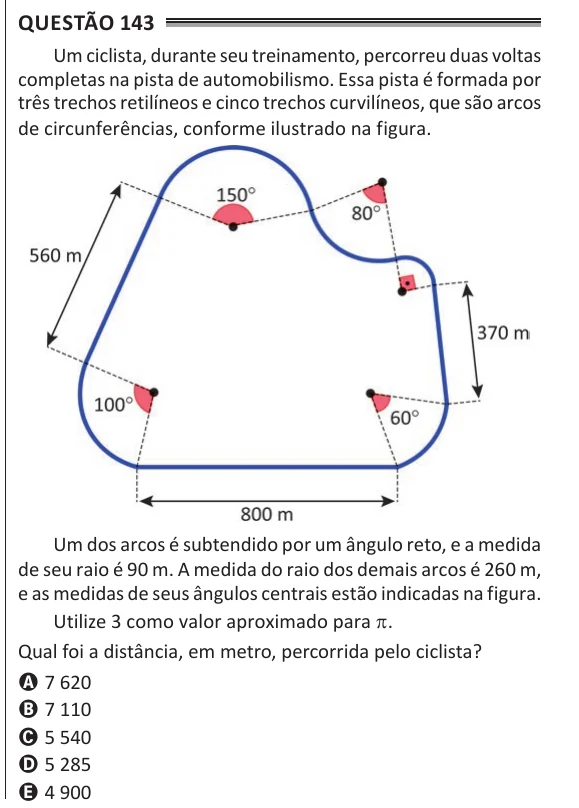

Texto extraído (pode conter ruído)

Questão 143  
Um ciclista, durante seu treinamento, percorreu duas voltas  
completas na pista de automobilismo. Essa pista é formada por  
três trechos retilíneos e cinco trechos curvilíneos, que são arcos  
de circunferências, conforme ilustrado na figura.  
Um dos arcos é subtendido por um ângulo reto, e a medida  
de seu raio é 90 m. A medida do raio dos demais arcos é 260 m,  
e as medidas de seus ângulos centrais estão indicadas na figura.  
Utilize 3 como valor aproximado para π.  
Qual foi a distância, em metro, percorrida pelo ciclista?  
A 7 620  
B 7 110  
C 5 540  
D 5 285  
E 4 900

