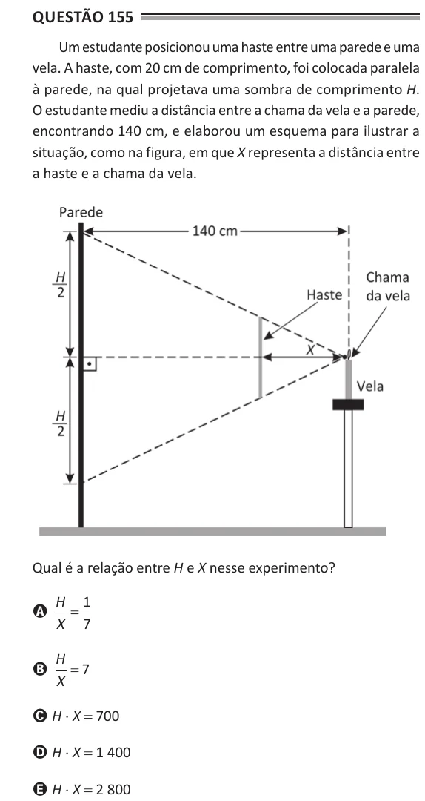

Texto extraído (pode conter ruído)

Questão 155  
Um estudante posicionou uma haste entre uma parede e uma  
vela. A haste, com 20 cm de comprimento, foi colocada paralela  
à parede, na qual projetava uma sombra de comprimento H.  
O estudante mediu a distância entre a chama da vela e a parede,  
encontrando 140 cm, e elaborou um esquema para ilustrar a  
situação, como na figura, em que X representa a distância entre  
a haste e a chama da vela.  
Qual é a relação entre H e X nesse experimento?  
H 1  
A  
=  
X 7  
H  
= 7  
B  
X  
C H ⋅ X = 700  
D H ⋅ X = 1 400  
E H ⋅ X = 2 800

