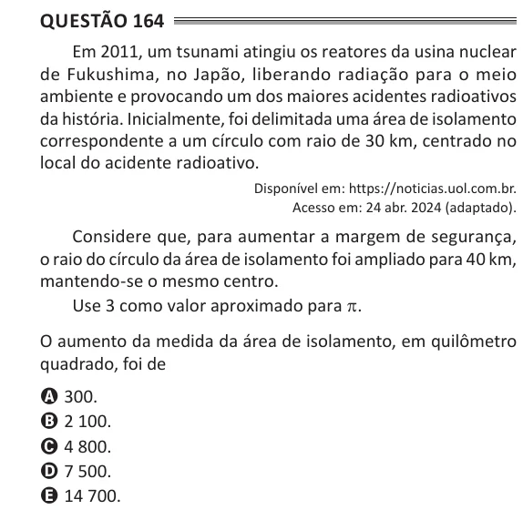

Texto extraído (pode conter ruído)

Questão 164  
Em 2011, um tsunami atingiu os reatores da usina nuclear  
de Fukushima, no Japão, liberando radiação para o meio  
ambiente e provocando um dos maiores acidentes radioativos  
da história. Inicialmente, foi delimitada uma área de isolamento  
correspondente a um círculo com raio de 30 km, centrado no  
local do acidente radioativo.  
Disponível em: https://noticias.uol.com.br.  
Acesso em: 24 abr. 2024 (adaptado).  
Considere que, para aumentar a margem de segurança,  
o raio do círculo da área de isolamento foi ampliado para 40 km,  
mantendo-se o mesmo centro.  
Use 3 como valor aproximado para π.  
O aumento da medida da área de isolamento, em quilômetro  
quadrado, foi de  
A 300.  
B 2 100.  
C 4 800.  
D 7 500.  
E 14 700.

