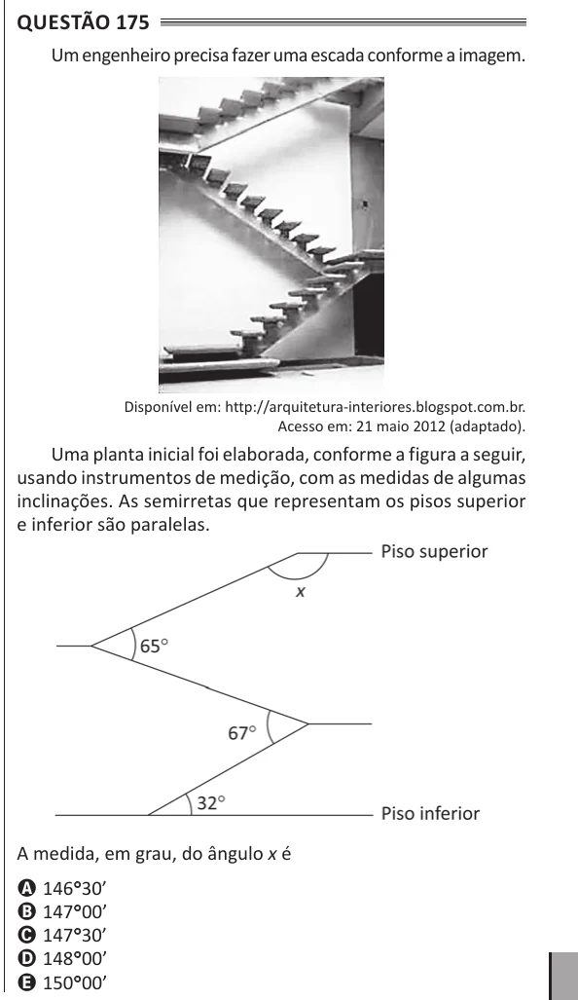

Texto extraído (pode conter ruído)

Questão 175  
Um engenheiro precisa fazer uma escada conforme a imagem.  
Disponível em: http://arquitetura-interiores.blogspot.com.br.  
Acesso em: 21 maio 2012 (adaptado).  
Uma planta inicial foi elaborada, conforme a figura a seguir,  
usando instrumentos de medição, com as medidas de algumas  
inclinações. As semirretas que representam os pisos superior  
e inferior são paralelas.  
A medida, em grau, do ângulo x é  
A 146°° 30’  
B 147°° 00’  
C 147°° 30’  
D 148°° 00’  
E 150°° 00’

