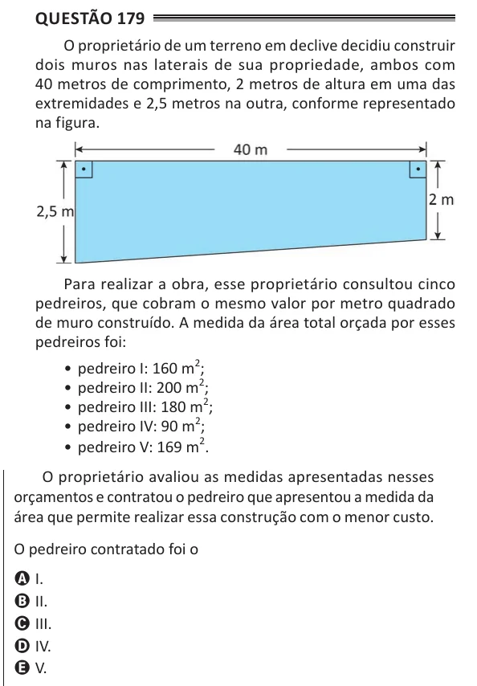

Texto extraído (pode conter ruído)

Questão 179  
O proprietário de um terreno em declive decidiu construir  
dois muros nas laterais de sua propriedade, ambos com  
40 metros de comprimento, 2 metros de altura em uma das  
extremidades e 2,5 metros na outra, conforme representado  
na figura.  
Para realizar a obra, esse proprietário consultou cinco  
pedreiros, que cobram o mesmo valor por metro quadrado  
de muro construído. A medida da área total orçada por esses  
pedreiros foi:  
• pedreiro I: 160 m 2 ;  
• pedreiro II: 200 m 2 ;  
• pedreiro III: 180 m 2 ;  
• pedreiro IV: 90 m 2 ;  
• pedreiro V: 169 m 2 .  
O proprietário avaliou as medidas apresentadas nesses  
orçamentos e contratou o pedreiro que apresentou a medida da  
área que permite realizar essa construção com o menor custo.  
O pedreiro contratado foi o  
A I.  
B II.  
C III.  
D IV.  
E V.

