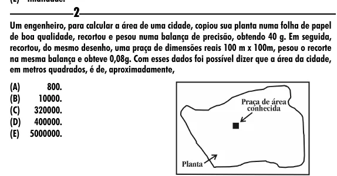

Texto extraído (pode conter ruído)

2  
Um engenheiro, para calcular a área de uma cidade, copiou sua planta numa folha de papel  
de boa qualidade, recortou e pesou numa balança de precisão, obtendo 40 g. Em seguida,  
recortou, do mesmo desenho, uma praça de dimensões reais 100 m x 100m, pesou o recorte  
na mesma balança e obteve 0,08g. Com esses dados foi possível dizer que a área da cidade,  
em metros quadrados, é de, aproximadamente,  
(A)  
800.  
(B)  
10000.  
(C) 320000.  
(D) 400000.  
(E) 5000000.

