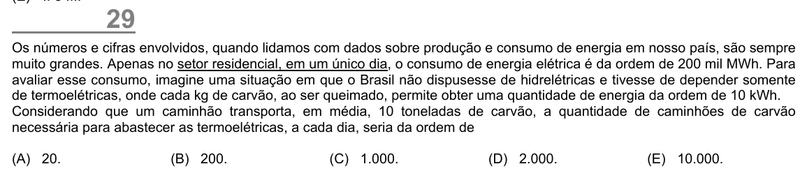

Texto extraído (pode conter ruído)

29  
Os números e cifras envolvidos, quando lidamos com dados sobre produção e consumo de energia em nosso país, são sempre  
muito grandes. Apenas no setor residencial, em um único dia, o consumo de energia elétrica é da ordem de 200 mil MWh. Para  
avaliar esse consumo, imagine uma situação em que o Brasil não dispusesse de hidrelétricas e tivesse de depender somente  
de termoelétricas, onde cada kg de carvão, ao ser queimado, permite obter uma quantidade de energia da ordem de 10 kWh.  
Considerando que um caminhão transporta, em média, 10 toneladas de carvão, a quantidade de caminhões de carvão  
necessária para abastecer as termoelétricas, a cada dia, seria da ordem de  
(A) 20.  
(B) 200.  
(C) 1.000.  
(D) 2.000.  
(E) 10.000.

