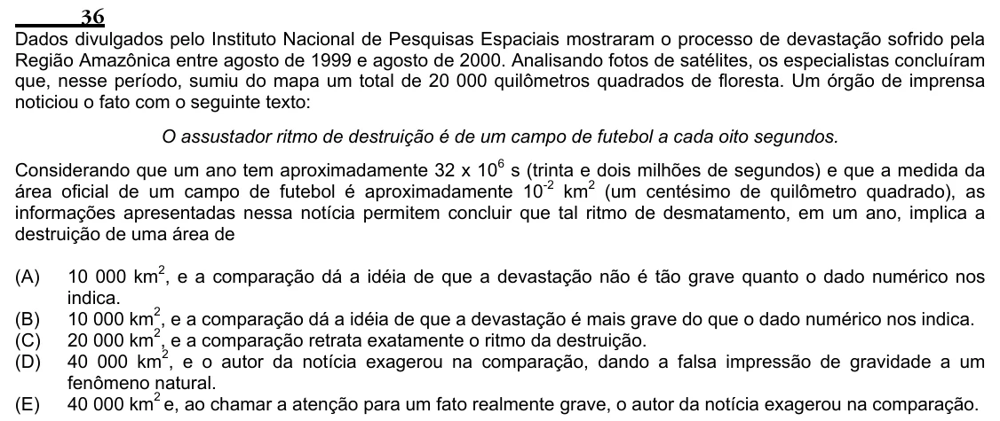

Texto extraído (pode conter ruído)

36  
Dados divulgados pelo Instituto Nacional de Pesquisas Espaciais mostraram o processo de devastação sofrido pela  
Região Amazônica entre agosto de 1999 e agosto de 2000. Analisando fotos de satélites, os especialistas concluíram  
que, nesse período, sumiu do mapa um total de 20 000 quilômetros quadrados de floresta. Um órgão de imprensa  
noticiou o fato com o seguinte texto:  
O assustador ritmo de destruição é de um campo de futebol a cada oito segundos.  
Considerando que um ano tem aproximadamente 32 x 10 6 s (trinta e dois milhões de segundos) e que a medida da  
área oficial de um campo de futebol é aproximadamente 10 -2 km 2 (um centésimo de quilômetro quadrado), as  
informações apresentadas nessa notícia permitem concluir que tal ritmo de desmatamento, em um ano, implica a  
destruição de uma área de  
(A)  
10 000 km 2 , e a comparação dá a idéia de que a devastação não é tão grave quanto o dado numérico nos  
indica.  
(B)  
10 000 km 2 , e a comparação dá a idéia de que a devastação é mais grave do que o dado numérico nos indica.  
20 000 km 2 , e a comparação retrata exatamente o ritmo da destruição.  
(C)  
40 000 km 2 , e o autor da notícia exagerou na comparação, dando a falsa impressão de gravidade a um  
(D)  
fenômeno natural.  
(E)  
40 000 km 2 e, ao chamar a atenção para um fato realmente grave, o autor da notícia exagerou na comparação.

