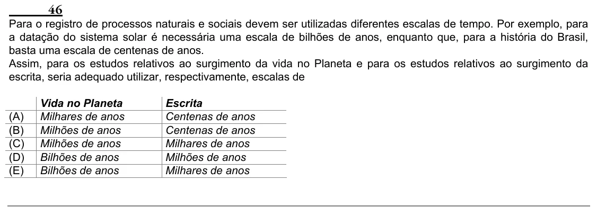

Texto extraído (pode conter ruído)

46  
Para o registro de processos naturais e sociais devem ser utilizadas diferentes escalas de tempo. Por exemplo, para  
a datação do sistema solar é necessária uma escala de bilhões de anos, enquanto que, para a história do Brasil,  
basta uma escala de centenas de anos.  
Assim, para os estudos relativos ao surgimento da vida no Planeta e para os estudos relativos ao surgimento da  
escrita, seria adequado utilizar, respectivamente, escalas de  
Vida no Planeta  
Escrita  
(A)  
Milhares de anos  
Centenas de anos  
(B)  
Milhões de anos  
Centenas de anos  
(C)  
Milhões de anos  
Milhares de anos  
(D)  
Bilhões de anos  
Milhões de anos  
(E)  
Bilhões de anos  
Milhares de anos

