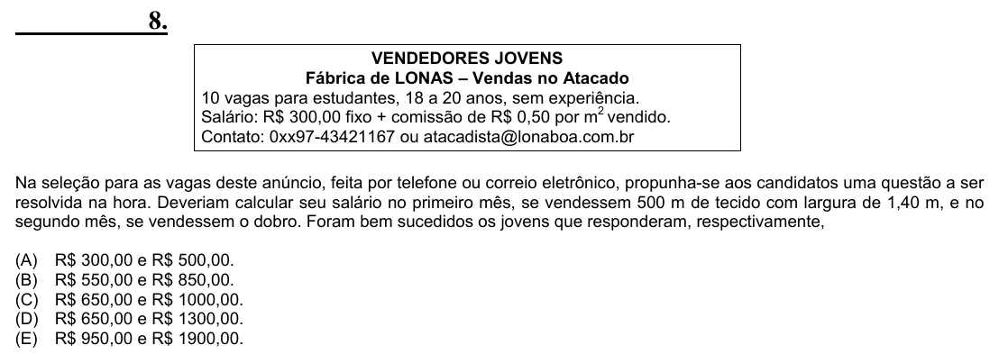

Texto extraído (pode conter ruído)

8.  
VENDEDORES JOVENS  
Fábrica de LONAS – Vendas no Atacado  
10 vagas para estudantes, 18 a 20 anos, sem experiência.  
Salário: R$ 300,00 fixo + comissão de R$ 0,50 por m 2 vendido.  
Contato: 0xx97-43421167 ou atacadista@lonaboa.com.br  
Na seleção para as vagas deste anúncio, feita por telefone ou correio eletrônico, propunha-se aos candidatos uma questão a ser  
resolvida na hora. Deveriam calcular seu salário no primeiro mês, se vendessem 500 m de tecido com largura de 1,40 m, e no  
segundo mês, se vendessem o dobro. Foram bem sucedidos os jovens que responderam, respectivamente,  
(A)  
R$ 300,00 e R$ 500,00.  
(B)  
R$ 550,00 e R$ 850,00.  
(C)  
R$ 650,00 e R$ 1000,00.  
(D)  
R$ 650,00 e R$ 1300,00.  
(E)  
R$ 950,00 e R$ 1900,00.

