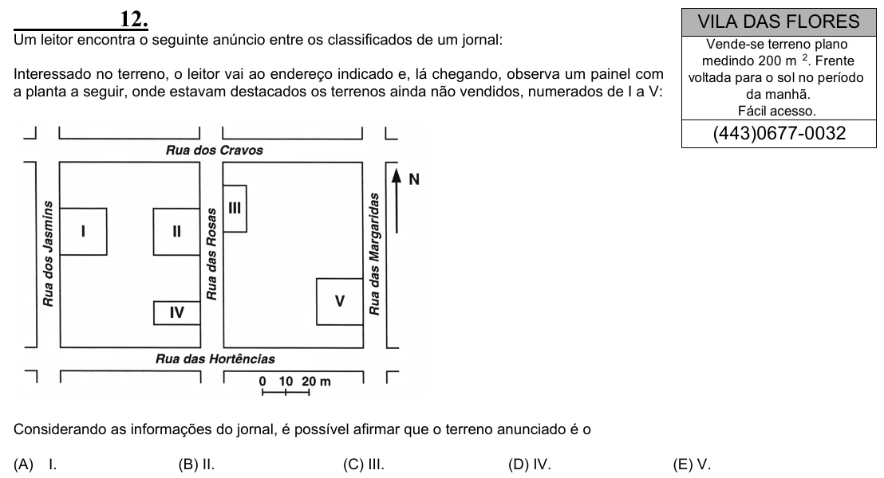

Texto extraído (pode conter ruído)

12.  
VILA DAS FLORES  
Um leitor encontra o seguinte anúncio entre os classificados de um jornal:  
Vende-se terreno plano  
medindo 200 m 2 . Frente  
Interessado no terreno, o leitor vai ao endereço indicado e, lá chegando, observa um painel com  
voltada para o sol no período  
a planta a seguir, onde estavam destacados os terrenos ainda não vendidos, numerados de I a V:  
da manhã.  
Fácil acesso.  
(443)0677-0032  
Considerando as informações do jornal, é possível afirmar que o terreno anunciado é o  
(A)  
I.  
(B) II.  
(C) III.  
(D) IV.  
(E) V.

