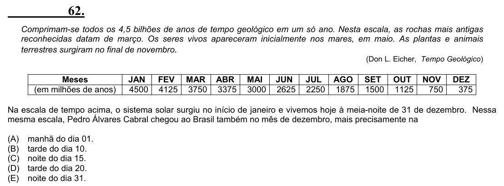

Texto extraído (pode conter ruído)

62.  
Comprimam-se todos os 4,5 bilhões de anos de tempo geológico em um só ano. Nesta escala, as rochas mais antigas  
reconhecidas datam de março. Os seres vivos apareceram inicialmente nos mares, em maio. As plantas e animais  
terrestres surgiram no final de novembro .  
(Don L. Eicher, Tempo Geológico)  
Meses  
JAN  
FEV MAR  
ABR  
MAI  
JUN  
JUL AGO  
SET  
OUT  
NOV  
DEZ  
(em milhões de anos)  
4500  
4125 3750  
3375  
3000  
2625  
2250 1875  
1500  
1125  
750  
375  
Na escala de tempo acima, o sistema solar surgiu no início de janeiro e vivemos hoje à meia-noite de 31 de dezembro. Nessa  
mesma escala, Pedro Álvares Cabral chegou ao Brasil também no mês de dezembro, mais precisamente na  
(A)  
manhã do dia 01.  
(B)  
tarde do dia 10.  
(C)  
noite do dia 15.  
(D)  
tarde do dia 20.  
(E)  
noite do dia 31.

