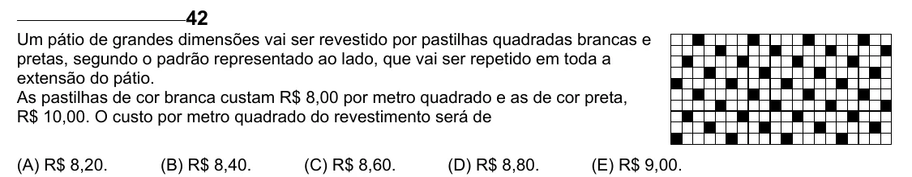

Texto extraído (pode conter ruído)

42  
Um pátio de grandes dimensões vai ser revestido por pastilhas quadradas brancas e  
pretas, segundo o padrão representado ao lado, que vai ser repetido em toda a  
extensão do pátio.  
As pastilhas de cor branca custam R$ 8,00 por metro quadrado e as de cor preta,  
R$ 10,00. O custo por metro quadrado do revestimento será de  
(A) R$ 8,20.  
(B) R$ 8,40.  
(C) R$ 8,60.  
(D) R$ 8,80.  
(E) R$ 9,00.

