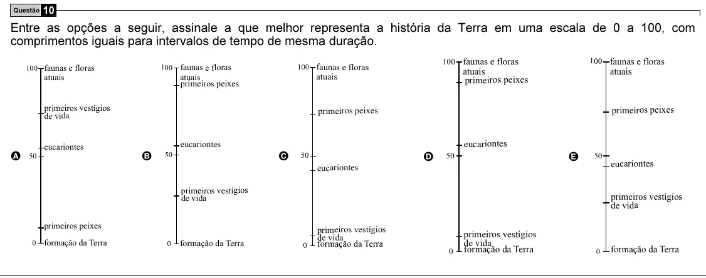

Texto extraído (pode conter ruído)

Questão 10  
Entre as opções a seguir, assinale a que melhor representa a história da Terra em uma escala de 0 a 100, com  
comprimentos iguais para intervalos de tempo de mesma duração.  
100 faunas e floras  
100 faunas e floras  
100 faunas e floras  
100  
faunas e floras  
100 faunas e floras  
atuais  
atuais  
atuais  
atuais  
atuais  
primeiros peixes  
primeiros peixes  
primeiros vestígios  
primeiros peixes  
primeiros peixes  
de vida  
eucariontes  
eucariontes  
eucariontes  
A 50  
B  
50  
C  
D  
50  
E  
50  
50  
eucariontes  
eucariontes  
primeiros vestígios  
primeiros vestígios  
de vida  
de vida  
primeiros peixes  
primeiros vestígios  
primeiros vestígios  
de vida  
0  
formação da Terra  
0  
formação da Terra  
de vida  
0  
formação da Terra  
0  
formação da Terra  
0  
formação da Terra

